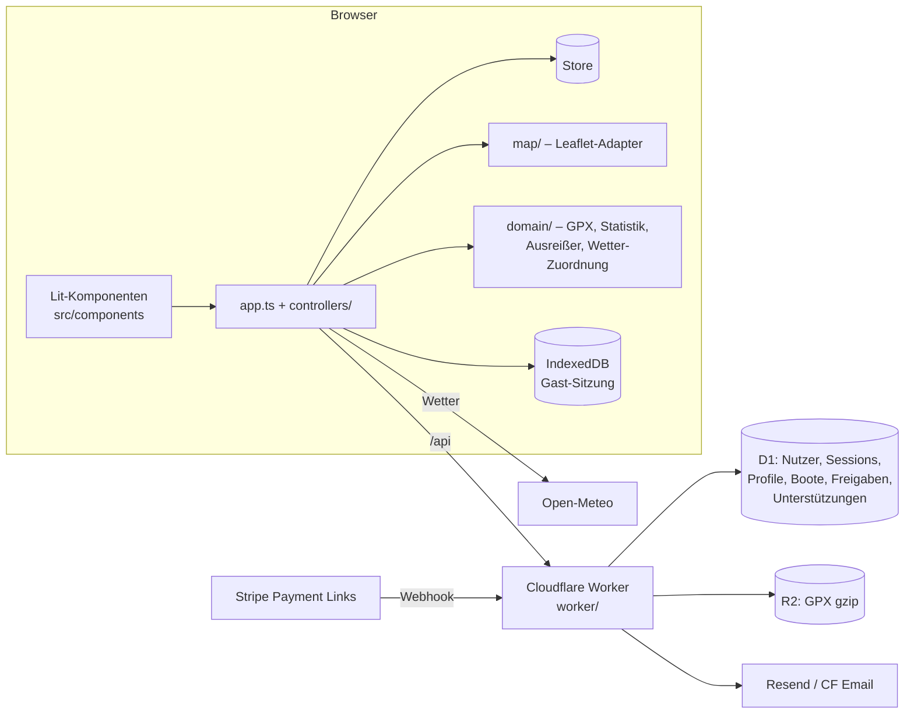

<p align="center">
  
</p>

<h1 align="center">Sail Explorer</h1>

<p align="center">
  Segeltörns aus GPX-Dateien auf der Seekarte – mit Fahrt, Wind, Böen und Wellen für genau diese Zeit.<br />
  Teilen per Link, Profile für Segler und Boote.<br />
  <a href="https://segeln-potsdam.de"><b>segeln-potsdam.de</b></a>
</p>

---

## Was es kann

| | |
|---|---|
| **Track auswerten** | GPX per Dateiauswahl oder Drag & Drop. Distanz, Fahrzeit, Ø/Max-Fahrt; GPS-Ausreißer werden robust (Median + MAD) erkannt und markiert. |
| **Wetter zur Fahrt** | Wind, Böen (Open-Meteo Forecast/Archiv) und Seegang (Marine-Modell) stündlich für Zeitraum und Gebiet – an jeden Trackpunkt gehängt. |
| **Karte** | Seekarte (Esri Ocean) bei Tag, Nachtkarte im Dark Mode, OpenSeaMap-Seezeichen, EMODnet-Wassertiefe. Track eingefärbt nach Fahrt, Wind, Böen oder Wellen. Eigene Symbole: Wind-Badges mit Knotenzahl, Wellen-Chevrons, Start-/Ziel-Pins. |
| **Alles verknüpft** | Hover (oder Tippen) auf Karte, Diagramm oder Max-Kennzahl zeigt denselben Moment überall. |
| **Gast-Sitzung** | Ohne Anmeldung bleibt alles im Browser (IndexedDB) und ist beim nächsten Besuch wieder da. |
| **Teilen** | Anmeldung per Magic Link, dann Upload. Links `/s/<id>` öffnen eine vollständig interaktive Ansicht; Einfärbung und Ebenen stehen in der URL. |
| **Sichtbarkeit** | Törns, Boote und Profile: **Öffentlich** (Standard, gelistet), **Nur mit Link** (geheimer Link `/s/<id>/<key>`, jederzeit erneuerbar) oder **Nur ich**. Kostenlos ist alles öffentlich; die beiden anderen Stufen gibt es für Unterstützer. |
| **Als Bild teilen** | Übersichtsbild im Quer- oder Quadratformat mit wählbaren Angaben (Start/Ziel, Dauer, Fahrt, Wind, Wellen …) am Rand – herunterladen oder über das Teilen-Menü des Geräts; dient auch als Link-Vorschau. |
| **Profile & Boote** | Profilseite `/u/<name>` und Bootsseiten `/b/<id>` mit Seemeilen und Törns. Boote haben einen Eigner (weitere Admins vorgesehen). |
| **Unterstützen** | 3 gespeicherte Törns pro Konto sind kostenlos. Wer mehr speichern will, gibt einmal einen Kaffee oder ein Bier aus (Stripe) – und hilft so, Server und Karten zu bezahlen. |
| **Entdecken** | Leiste „Zuletzt gesegelt“ auf der Startseite und Seite `/entdecken` mit den neuesten öffentlichen Törns, Booten und Seglern – ausschließlich Inhalte, die ohnehin öffentlich sind (`GET /api/discover`). |
| **Community-Startseite** | Der Stream steht im Mittelpunkt: Gäste sehen „Neues aus der Community“ (filterbar nach Hafen und Verein), Angemeldete „Neuigkeiten aus deinem Verein, Hafen und Team“. „Track anlegen“ sitzt als Knopf in der Kopfzeile, als kompakte Karte und mobil als runder Knopf; Drag & Drop geht überall. |
| **Verein, Hafen, Team** | „Mein Verein“ und Heimathafen im Konto, Häfen als eigene Seiten `/h/<slug>` (Boote wählen ihren Hafen per Autovervollständigung), Teams zeigen die Törns ihrer Mitglieder. |
| **Reaktionen** | „Gefällt mir“, „Mast- und Schotbruch“, „Starker Schlag“ auf Törns, Beiträge, Fotos und Neuigkeiten – eine pro Person, nur auf Sichtbares. |
| **Läuft überall** | Hell/Dunkel, Tastatur, Screenreader-Texte, mobil als Bottom-Sheet. |

## Schnellstart

```bash
npm install
```

```bash
npm run db:migrate:local
```

```bash
npm run dev
```

Die App läuft dann auf <http://localhost:5173> **und im LAN** (die Netzwerk-Adresse steht in der Konsole, z. B. `http://192.168.1.20:5173`) – so lässt sie sich während der Entwicklung direkt auf dem Handy testen, inklusive Login. Lokal werden keine Mails verschickt: der Magic Link erscheint im Anmeldedialog und im Terminal.

> Windows: Falls das Handy die Seite nicht erreicht, Port 5173 in der Windows-Firewall für private Netzwerke freigeben.

Lokale Einstellungen stehen in `.dev.vars` (Vorlage: `.dev.vars.example`).

## Prüfen

```bash
npm run check
```

Übersichtsbild ohne Browser rendern (zum Prüfen des Layouts):

```bash
npx tsx scripts/render-share-image.ts square share.png
```

führt Typprüfung (App + Worker), alle Tests und den Build aus. Die Tests sind nach den funktionalen Anforderungen benannt (`[F-33] …`, siehe [docs/REQUIREMENTS.md](docs/REQUIREMENTS.md)); Worker-Tests laufen gegen echte lokale D1/R2-Bindings.

## Architektur



- **Schichten:** `domain` (rein, getestet) → `services` (Netz, Store) → `map`/`components` (Darstellung) → `app.ts`/`controllers` (Verdrahtung).
- **Rechnen im Browser:** Der Worker speichert und liefert nur aus – das hält ihn im Free-Tier (10 ms CPU).
- Details: [docs/PRINCIPLES.md](docs/PRINCIPLES.md) (Design-, Architektur- und Security-Prinzipien), [docs/PLATFORM.md](docs/PLATFORM.md) (Weg zur sozialen Plattform).

```
src/
  domain/        GPX-Parser, Statistik, Metriken, Zeitachsen, Wetter-Zuordnung, Formate
  services/      API-Client, Store, URL-Zustand, Wetter-API, Kompression, Arbeitsbereich
  map/           Leaflet-Adapter und eigene Kartensymbole
  components/    Lit Web Components (sx-*)
  controllers/   Konto, Teilen, Profile, Boote
  styles/        Design-Tokens und Layout
worker/          API, Auth (Magic Link), Freigaben, Profile, Boote, Entdecken, Security-Header
migrations/      D1-Schema
test/            Unit- und Funktionstests
```

## Sicherheit in Kürze

Strikte CSP ohne Inline-Skripte und ohne CDNs · HttpOnly-Session-Cookie (`__Host-`), SameSite=Lax + Origin-Prüfung · Tokens nur als SHA-256-Hash gespeichert · Magic Links werden erst nach Bestätigung eingelöst · Rate-Limits, Größen- und Speicherkontingente, Dekompressions-Limit · fremde und private Objekte sind 404 · in Produktion verweigert der Server die Anmeldung, solange Mailversand oder Bot-Schutz fehlen.

## Deployment (Cloudflare)

Einmalig einrichten:

```bash
npx wrangler d1 create sailing-explorer
```

→ `database_id` in `wrangler.jsonc` eintragen.

```bash
npx wrangler r2 bucket create sailing-explorer-tracks
```

```bash
npx wrangler secret put TURNSTILE_SECRET
```

```bash
npx wrangler secret put RESEND_API_KEY
```

- **Turnstile:** Widget im Cloudflare-Dashboard anlegen (Domains `segeln-potsdam.de` und `sailing.wollow.ski`), Site-Key in `wrangler.jsonc` → `TURNSTILE_SITE_KEY`.
- **Mail:** Resend-Konto, Domain `sailing.wollow.ski` verifizieren (DNS bei Cloudflare), Absender in `MAIL_FROM`.
- **Domain:** Hauptadresse ist `segeln-potsdam.de` (Zone im selben Cloudflare-Konto). `www.`, alle sonst nicht belegten Subdomains (proxied `*`-Eintrag + Worker-Route) und die frühere Adresse `sailing.wollow.ski` leiten per 301 mit Pfad dorthin weiter (`worker/canonical.ts`, Variablen `CANONICAL_HOST`, `ALIAS_HOSTS`). Ausnahme: der Stripe-Webhook antwortet unter jeder Adresse direkt. Vorschauen laufen unter `dev-<branch>.segeln-potsdam.de`.

Danach deployt die CI bei jedem Push auf den Standardzweig.

### Unterstützen (Stripe)

Pro Konto sind `FREE_SHARES` (Standard 3) gespeicherte Törns kostenlos. Ab dem nächsten zeigt „Teilen“ eine Karte zum Unterstützen. Der Betrag wird per Schieberegler gewählt: Kaffee 3 €, Bier 5 €, Runde 10 €, Kiste 20 €, Skipper-Dank 50 €. Unterstützung und Aufbewahrung gelten **je Saison (Kalenderjahr)**: Eine Zahlung macht das Konto bis 31.12. zum Unterstützer (ab November für die nächste Saison), jede weitere hängt eine Saison an. Törns werden am 1. Februar nach ihrer bzw. der letzten unterstützten Saison gelöscht; im Dezember kommt eine freundliche Saison-Erinnerung (Konzept 5.5). Kostenlose Konten haben höchstens 3 Boote; auch für Unterstützer gelten feste Obergrenzen: 100 Törns, 200 MB (Tracks und Übersichtsbilder) und 20 Boote pro Konto (`src/domain/limits.ts`). Eine globale Notbremse pausiert neue Törns kostenloser Konten ab `STORAGE_SOFT_BYTES` (Standard 8·10⁹ Byte) und aller Konten ab `STORAGE_HARD_BYTES` (9,5·10⁹ Byte); der Zähler `counters.storage_bytes` wird nächtlich neu berechnet. Der Worker legt dafür eine Stripe-Checkout-Session an (`POST /api/support/checkout`), freigeschaltet wird **nur** über den signierten Webhook, nie über eine Angabe des Browsers. Ohne beide Secrets bleibt Unterstützen aus: kein Angebot, und der 4. Törn wird mit Hinweis abgelehnt.

1. **Secret Key setzen** (Stripe-Dashboard → *Entwickler → API-Schlüssel*). Am besten einen eingeschränkten Schlüssel verwenden, der nur *Checkout Sessions: Schreiben* darf:

```bash
npx wrangler secret put STRIPE_SECRET_KEY
```

2. **Webhook anlegen** (*Entwickler → Webhooks → Endpunkt hinzufügen*):
   - URL: `https://segeln-potsdam.de/api/webhooks/stripe`
   - Ereignisse: `checkout.session.completed` und `checkout.session.async_payment_succeeded` (für verzögerte Zahlarten wie SEPA)
3. **Signatur-Secret setzen** (`whsec_…` aus dem Webhook-Endpunkt):

```bash
npx wrangler secret put STRIPE_WEBHOOK_SECRET
```

**Ohne Zahlung freischalten** (Betreiber, Testkonten, Vereinsvorstand): eine Zeile mit `provider = 'grant'` in `supports` – Kontingente und Aufbewahrung behandeln sie wie eine Zahlung, Löschen der Zeile nimmt sie zurück:

```bash
npx wrangler d1 execute sailing-explorer --remote --command "INSERT INTO supports (id, user_id, provider, provider_ref, amount, created_at, valid_until) VALUES ('grant-<name>', '<Konto-ID>', 'grant', 'grant:<name>', 0, unixepoch()*1000, <Ende in ms>)"
```

Lokal testen: Testmodus-Schlüssel `sk_test_…` in `.dev.vars` eintragen und Ereignisse mit der Stripe-CLI weiterleiten. `stripe listen --forward-to localhost:5173/api/webhooks/stripe` gibt das passende `whsec_…` aus.

### Kommentare und Moderation

Kommentare und Melden (Konzept Abschnitt 4) brauchen zwei Angaben:

```bash
# Konto-IDs der Moderation, kommagetrennt (ID z. B. per `wrangler d1 execute … "SELECT id FROM users WHERE email = '…'"`)
npx wrangler secret put ADMIN_USER_IDS
# Kontaktadresse für Meldungen ohne Konto (Impressum, Art. 16 DSA) – als Variable in wrangler.jsonc oder als Secret
npx wrangler secret put REPORT_CONTACT
```

Ohne `ADMIN_USER_IDS` gibt es keine Admin-Oberfläche (die Admin-Routen antworten 404); Meldungen werden trotzdem gespeichert und blenden bei 3 Meldungen bzw. „Ich bin abgebildet“ automatisch aus. Admins sehen offene Meldungen im Konto unter „Meldungen“.

### Benachrichtigungen: Push und Live

Die Glocke (Konzept Abschnitt 17) läuft ohne Einrichtung. **Live** (WebSocket) nutzt das Durable Object
`NotificationHub` aus `wrangler.jsonc` – SQLite-basiert, im Free Tier enthalten, wird beim Deploy angelegt.
**Push** braucht ein VAPID-Schlüsselpaar; ohne ist die Auswahl „Push“ ausgegraut:

```bash
node scripts/vapid-keys.mjs                 # gibt beide Werte aus
npx wrangler secret put VAPID_PUBLIC_KEY
npx wrangler secret put VAPID_PRIVATE_KEY
```

Die Weckrufe sind leer (keine Inhalte bei Google, Apple, Mozilla, Microsoft); den Text holt `public/sw.js` selbst.
Auf iPhone und iPad gibt es Push nur in der App vom Home-Bildschirm.

### Impressum und Datenschutz

`/impressum` und `/datenschutz` kommen aus **einer** Datei: `src/content/legal.ts` (statische SPA-Seiten, laufen auch ohne
Backend; verlinkt auf der Startseite, im Konto-Dialog und in jeder Mail). Die Betreiberangaben stehen im Objekt
`OPERATOR` – Werte wie `[NAME DES BETREIBERS]` sind Platzhalter; solange einer übrig ist, zeigen beide Seiten einen
deutlichen Warnhinweis. `OPERATOR.reportEmail` sollte dem Worker-Wert `REPORT_CONTACT` entsprechen.

> **Vorlage, keine Rechtsberatung:** Die Texte beschreiben, was der Code tatsächlich tut (Cloudflare, Resend, Stripe,
> Open-Meteo, Kartenkacheln, Fristen, Rechte), ersetzen aber keine Prüfung durch eine fachkundige Person. Vor dem Livegang
> (z. B. unter segeln-potsdam.de) Angaben ausfüllen, Auftragsverarbeitungsverträge (Cloudflare, Resend, Stripe) abschließen
> und die Texte prüfen lassen; bei Änderungen an Diensten oder Fristen `src/content/legal.ts` mitpflegen.

### Aufbewahrung und Aufräumen

Ein Cron-Trigger (`17 3 * * *` UTC, siehe `wrangler.jsonc`) räumt nachts auf (`worker/retention.ts`):

| Was | Regel |
|---|---|
| Kostenlose Törns | 3 Monate ab Upload |
| Törns von Unterstützern | bis Ende des Unterstützer-Status + 3 Monate (auch ältere Törns profitieren) |
| Erinnerung | eine Mail pro Konto 14 Tage vor dem Löschen, je Törn einmal |
| Inaktive Konten | ohne Törns und 12 Monate ohne Anmeldung → Konto, Profil und Boote werden gelöscht |
| Login-Links, Sessions | nach Ablauf |
| Kommentare | mit ihrem Törn; Sammelmail (opt-in) höchstens 25 pro Lauf |
| Meldungen | verwaiste sofort, entschiedene (anonymisiert) nach 180 Tagen; Spam-Zähler der Kommentare nach 24 h |
| Reaktionen | mit ihrem Gegenstand (Törn, Foto, Beitrag, Neuigkeit) bzw. Konto; verwaiste nachts; Zähler nach 24 h |

Pro Lauf werden höchstens 200 Törns gelöscht und 50 Konten benachrichtigt bzw. entfernt; der Rest folgt in der nächsten Nacht. Das Ablaufdatum berechnet die Datenbank (`EXPIRES_SQL` in `worker/shares.ts`, gleiche Regel wie `shareExpiry()` in `src/domain/support.ts`). Eigentümer sehen es im Konto bei jedem Törn.

> **Hinweis (keine Rechtsberatung):** Ist die „Spende“ an eine Gegenleistung gekoppelt (hier: weitere gespeicherte Törns), gilt sie steuerlich in der Regel nicht als Spende, sondern als Verkauf einer Leistung. Vor dem Livegang Impressum, Umsatzsteuer (ggf. Kleinunternehmerregelung) und Widerrufsbelehrung für digitale Leistungen prüfen; in Stripe nicht „Spende“ als Produktbezeichnung verwenden, sondern z. B. „Unterstützung: weitere Törns speichern“.

### Kosten

| Dienst | Free-Tier | Hinweis |
|---|---|---|
| Workers | 100 000 Anfragen/Tag | Rechenarbeit liegt im Browser |
| D1 | 5 GB, 5 Mio. Lesezugriffe/Tag | |
| R2 | 10 GB, keine Egress-Kosten | Zahlungsmittel muss hinterlegt sein |
| Turnstile, Rate Limiting, Custom Domain | kostenlos | |
| Stripe | keine Grundgebühr | Gebühr pro Zahlung (bei 3 € fällt der Fixanteil spürbar ins Gewicht) |
| Mail | Resend: 3 000/Monat | Cloudflare Email Sending an beliebige Empfänger erst mit Workers Paid (5 $/Monat) |
| Kartenkacheln | OSM, OpenSeaMap, EMODnet, Esri | Nutzungsbedingungen der Anbieter beachten (Esri-Basiskarten: Attribution; bei kommerzieller Nutzung prüfen) |

## CI/CD: Forgejo + Woodpecker → GitHub

Primäres Repository ist Forgejo (`git.office.wollow.ski`), gebaut wird mit Woodpecker (`ci.office.wollow.ski`), GitHub erhält eine Spiegelung.

1. **Woodpecker:** Repo aktivieren, Secret `cloudflare_api_token` anlegen (nur für den Deploy-Schritt / Push-Events).
2. **Pipeline:** [.woodpecker.yaml](.woodpecker.yaml) – `install` → `check` (Typen, Tests, Build) → `deploy` (D1-Migrationen + `wrangler deploy`, nur Standardzweig). Läuft auf dem NUC (`labels: speed: fast`).
   - **Vorschau je Branch:** jeder andere Branch landet als eigener Worker unter `https://dev-<branch>.segeln-potsdam.de` (Präfix `feature/` entfällt) mit Vorschau-Datenbank und -Bucket ([scripts/deploy-preview.mjs](scripts/deploy-preview.mjs)); beim Schließen des Pull Requests wird sie gelöscht. Anmeldung/Teilen sind in Vorschauen gesperrt.
3. **Spiegel zu GitHub:** In Forgejo unter *Einstellungen → Repository → Spiegel-Einstellungen* einen Push-Mirror auf `https://github.com/tofixx/sailing-explorer.git` anlegen (GitHub-Token mit `contents: write`), „bei Push synchronisieren“ aktivieren.

## Lizenz & Quellen

Kartendaten © OpenStreetMap-Mitwirkende, © OpenSeaMap, © EMODnet Bathymetry, Kacheln © Esri. Wetterdaten: [Open-Meteo](https://open-meteo.com) (CC BY 4.0).
